  

> Life is like a game, and we are all in. While we are at it, we shall play the most magnificent game ever.

**Stuff I built, mostly at hackathons:**

- [**pawmatch**](https://github.com/abhinxx/pawmatch): Bumble for shelter dogs, with agents that book the real meetup. 3rd at Dogathon SF, on my second day in the city.
- [**saathi-robot**](https://github.com/abhinxx/saathi-robot): a robot hand whose only job is to hold yours in the dark, and talk to you in Nepali.
- [**bmw-backseat**](https://github.com/abhinxx/bmw-backseat): a room full of AI customers for BMW product managers. 3rd at the European Hackathon League finals.
- [**sentinel**](https://github.com/abhinxx/sentinel): catches a voice agent lying in under two seconds.
- [**mission-control**](https://github.com/abhinxx/mission-control): my whole PM job on one screen, run by Claude Code.

Say hi at [pmabhi.com](https://pmabhi.com) or [grab 30 minutes](https://cal.com/pmabhi/30min).
